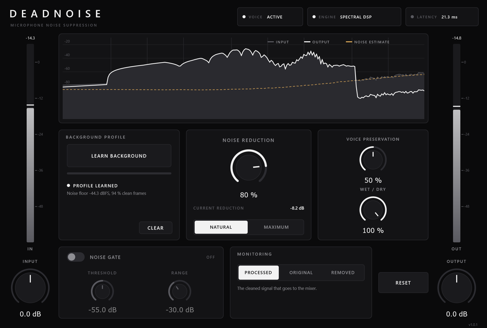

# DEADNOISE

Real-time microphone noise suppression for FL Studio: a Windows x64 **VST3**
plugin that removes the constant high-frequency hiss of a USB microphone while
keeping the voice natural, continuously, while you speak (it is not a gate).



---

## 1. Install

Download **`DEADNOISE-FL-STUDIO-WINDOWS-x64.zip`**, either from
[`bin/`](bin) or from the GitHub Release `deadnoise-v1.0.1`.
[`bin/INSTALLATION.txt`](bin/INSTALLATION.txt) has the step-by-step guide and
[`bin/TEST_REPORT.txt`](bin/TEST_REPORT.txt) the test results of that exact file.

The ZIP contains only the VST3 bundle `DEADNOISE.vst3/`. Extract it directly into
your plugin folder (for example `D:\Plugins`), which gives
`D:\Plugins\DEADNOISE.vst3\Contents\x86_64-win\DEADNOISE.vst3`. Unblock the
ZIP first (right-click, Properties, Unblock). Then in FL Studio go to
**Options, Manage plugins, Find installed plugins** with *Verify plugins* ticked.

It's built with MSVC (Visual Studio 2022, Release, static runtime) on a GitHub
Windows runner. It needs no Visual C++ redistributable and no other DLLs.

## 2. Use it on your microphone (FL Studio)

1. In the Mixer, select the insert that receives your USB microphone
   (*Audio input* set to the mic, mono input is fine).
2. Put **DEADNOISE in the first slot**, before EQ/compression (compressors raise
   the noise floor; clean first).
3. **Stay silent and click _LEARN BACKGROUND_.** It listens for 4 seconds.
   The panel shows *PROFILE LEARNED*, the measured noise floor and how much of
   the capture was clean. If you made sounds, it refuses
   (*"Too much sound during learning"*) instead of learning your voice.
4. Talk. The default (Natural, 80 %) already removes the hiss by ~25 dB in
   pauses and keeps suppressing it under your voice. Want it quieter? Go to
   100 % (≈ 32 dB) or switch to **Maximum** (≈ 60 dB).
5. Check with **MONITORING**:
   * *Original*: the unprocessed input, time-aligned, for honest A/B.
   * *Removed*: only what DEADNOISE takes away. You should hear hiss, not
     words. Words in there mean the reduction is too strong for your signal:
     raise *Voice Preservation* or lower *Noise Reduction*.
6. Save the project. The learned profile is stored with the plugin state
   (project, mixer state and presets).

**Learn again** when you change the microphone, its hardware gain, the room,
or the sample rate, or when the panel says *"Background changed. Relearn
recommended."* Changing DEADNOISE's own *Input* knob does **not** require
relearning (the profile is scaled with it).

Without a learned profile DEADNOISE still works: it tracks the noise floor
adaptively (*ADAPTIVE (NO PROFILE)*). The learned profile is more accurate.

## 3. Controls

| Control | Range (default) | What it does |
|---|---|---|
| **Noise Reduction** | 0–100 % (80 %) | Depth of suppression. 0 % is bit-transparent (pure delay). Natural: up to 32 dB, Maximum: up to 60 dB in pauses. |
| **Processing Mode** | Natural / Maximum | *Natural*: transparent voice, constant attenuated residual. *Maximum*: much deeper floor and slight noise over-estimation; at low SNR it also removes some high-frequency consonant energy. |
| **Voice Preservation** | 0–100 % (50 %) | Higher = more sensitive speech detection, longer hold/release (word endings, breaths, sibilance kept), less over-subtraction. Lower = cleaner, drier. |
| **Wet / Dry** | 0–100 % (100 %) | Blend with the latency-aligned original. |
| **Learn Background** | button | 4 s capture of the background noise → noise profile. *Cancel* while running. *Clear* forgets the profile. |
| **Noise Gate** | on/off (off) + Threshold (−55 dBFS), Range (30 dB) | Optional, gentle secondary gate after the denoiser. Its detector listens to the *cleaned* signal. Not needed for hiss removal. |
| **Input** | ±24 dB (0) | Gain before processing (meters show the result). |
| **Output** | ±24 dB (0) | Final gain. |
| **Monitoring** | Processed / Original / Removed | See above. Switching is click-free. |
| **Reset** | button | All controls back to defaults. The learned profile is kept. |

All controls are automatable VST3 parameters. Learn / Clear / Reset are actions
(not parameters) so that automation can never retrigger learning.

The display shows the input spectrum (grey), output (white) and the current
noise estimate (dashed). *Current reduction* is the energy removed right now;
the *VOICE* chip lights while speech is detected.

## 4. Latency and CPU

| Sample rate | FFT / latency | |
|---|---|---|
| 44.1 kHz | 1024 samples | 23.2 ms |
| 48 kHz | 1024 samples | 21.3 ms |
| 88.2 / 96 kHz | 2048 samples | 21.3 ms |

The latency is reported to FL Studio, so plugin delay compensation keeps
recordings aligned. When the host bypasses the plugin through its VST3 bypass
parameter, the same delay is kept (no time jump when toggling); how FL Studio's
own mixer-slot bypass behaves was not verified. If you monitor yourself live
through FL Studio, you hear these ~21 ms on top of your audio interface latency.

CPU: about 1 % of one CPU core per channel at 48 kHz. Measured on the Windows CI
machines (MSVC build) for **stereo**: 1.3–2.0 % of one core at 48 kHz and
2.6–4.0 % at 96 kHz across runs (latest in `docs/ci/dsp-tests-windows.txt`).

## 5. How it works (short)

Short-time Fourier transform (Hann, 75 % overlap, ~21 ms window). For every
frequency bin and frame:

1. **Noise estimate**: the learned profile (robust 4 s measurement that rejects
   frames with speech, breath or clicks using minimum statistics and a Gamma
   model of the band energies), scaled by the input gain and slowly
   level-corrected per band. Without a profile: an SPP-based MMSE noise tracker
   (Gerkmann & Hendriks 2012), smoothed in time and frequency.
2. **A-priori SNR**: decision-directed estimate (Ephraim & Malah).
3. **Gain**: MMSE log-spectral amplitude estimator, weighted by a
   speech-presence probability with IMCRA-style local / global / frame
   evidence (Cohen's OM-LSA). Speech-free bins *between and above* the speech
   harmonics are suppressed while you talk; speech bins keep their level.
4. **Artifact control**: the floor is reached through the speech-presence
   probability, so isolated noise peaks do not open (no musical noise);
   per-bin release smoothing keeps word endings and breaths; frame-level
   presence hold avoids pumping; likelihood-based onset evidence keeps word
   attacks.

Stereo input is processed with linked gains, so both channels get the same
gain and the image is preserved. The audio thread never allocates, locks or does
I/O (verified by a test that counts heap allocations during `process()`).
Profile analysis runs on a background thread and is handed over lock-free.

## 6. Tests

Everything below was run automatically, see **[docs/TEST_REPORT.md](docs/TEST_REPORT.md)**
for full numbers.

* DSP test-suite (69 checks) on Linux and on **native Windows (MSVC build)**:
  FFT, bit-exact transparency, exact latency at 44.1/48/96 kHz, silence, NaN/Inf
  input, random block sizes 1–4096, zero heap allocations on the audio thread,
  learning accuracy (≤ 0.5 dB) and speech rejection, suppression depth, speech
  preservation, stereo, monitor modes, gate, profile reuse across sample rates,
  random automation stress, CPU.
* **Steinberg VST3 validator** (extensive mode): 537 / 537 passed on Windows.
* **pluginval** strictness 10 on Windows: passed (editor, state, automation,
  thread safety, fuzzing, buses).
* **Host-level test** on Windows: loads the `.vst3` through VST3 hosting like a
  DAW, checks latency, layouts, transparency, suppression, state and profile
  persistence through the VST3 component state, and editor open/close.
* **Objective audio evaluation** (PESQ, STOI, SI-SDR, noise attenuation,
  musical-noise indicator, per-band speech preservation) on 23 scenarios.

## 7. Build from source

Requirements: CMake ≥ 3.22, a C++17 compiler, JUCE 8 (fetched automatically).

**Windows (supported toolchain, Visual Studio 2022):**

```bat
cmake -S DEADNOISE -B build -G "Visual Studio 17 2022" -A x64 -DCMAKE_MSVC_RUNTIME_LIBRARY=MultiThreaded
cmake --build build --config Release
```

The plugin ends up in `build\DEADNOISE_artefacts\Release\VST3\DEADNOISE.vst3`.
The same steps run in [`.github/workflows/deadnoise-windows.yml`](../.github/workflows/deadnoise-windows.yml),
which also runs all tests and commits the binary to `DEADNOISE/bin/`.

**Linux (DSP tests, CLI, a Linux VST3 for testing):**

```bash
cmake -S DEADNOISE -B build -G Ninja -DCMAKE_BUILD_TYPE=Release
```

```bash
ninja -C build && ./build/deadnoise_tests
```

Tools:
* `deadnoise_cli`: run the exact plugin DSP on a WAV file
  (`--learn-at 0.5 --reduction 0.8 --mode natural|max --voice 0.5 ...`).
* `tools/make_testset.py` + `tools/evaluate.py` + `tools/summarize.py`:
  regenerate the evaluation.
* `deadnoise_host_test`, `deadnoise_screenshot`: host-level test and UI render.

(JUCE 8 dropped MinGW support, so Windows binaries are built with MSVC only.)

## 8. Known limitations

* **Tested without your microphone.** All audio tests use synthetic USB-style
  hiss, white noise and public speech recordings (LibriSpeech; a 48 kHz
  full-band speech sample). The final judgement needs a listening test with
  your real microphone in FL Studio (see the report for what to check).
* **Not tested inside FL Studio itself** (no Windows desktop with FL Studio in
  the build environment). It was tested with Steinberg's validator, pluginval and
  a VST3 host on Windows, the standard conformance tools.
* Designed for **stationary or slowly changing noise** (hiss, electronic noise,
  fan, hum). Transient noises (keyboard, clicks, traffic, voices in the room) are
  not removed; a recorded *event* noise in the evaluation was barely reduced.
* *Maximum* mode at low SNR also removes high-frequency consonant energy that
  lies below the hiss (measured −4…−10 dB at 4–8 kHz at 10–20 dB SNR).
  Use Natural or raise Voice Preservation if "s" sounds get dull.
* ~21 ms latency (STFT window). Compensated in recording; audible as delay if
  you monitor yourself live through FL Studio.
* Stereo channels share one gain (designed for a mono mic on a stereo insert).
* A profile learned at one sample rate is re-mapped when the rate changes, but
  relearning is recommended (the panel says so).
* No neural network engine is included. DeepFilterNet 3 was built and measured
  and was not suitable for this use; see
  [docs/NEURAL_ENGINE_EVALUATION.md](docs/NEURAL_ENGINE_EVALUATION.md).
* The binary is not code-signed (personal use); Windows may ask once.

## 9. Licenses

See [THIRD_PARTY_LICENSES.md](THIRD_PARTY_LICENSES.md). DEADNOISE uses JUCE 8
under the AGPLv3 and the Steinberg VST3 SDK (MIT).
